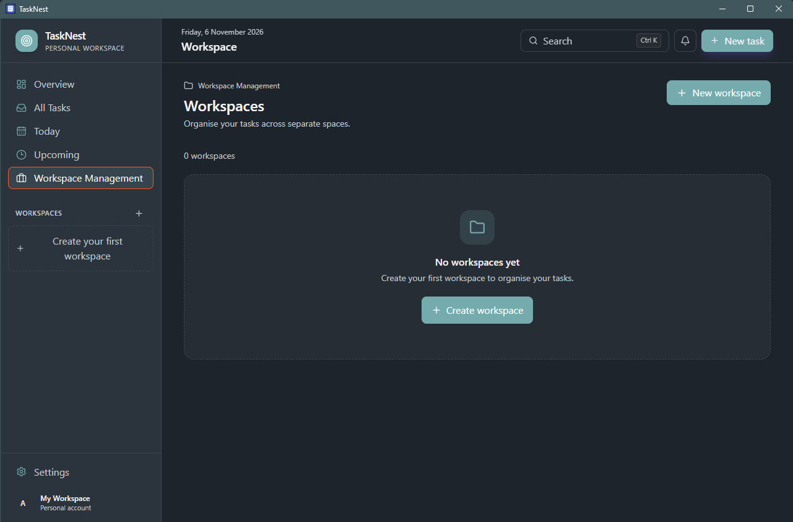
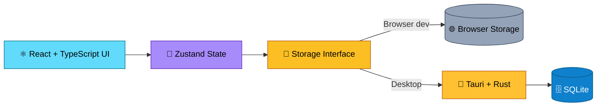

<div align="center">


<br />

**An offline-first workspace and task management application for people who want a clear, structured place to manage projects and everyday work.**

<br />


<br />


<br /><br />

[**✨ Features**](#-features) &nbsp;•&nbsp;
[**🖼️ Preview**](#️-preview) &nbsp;•&nbsp;
[**⬇️ Download**](#️-download--install) &nbsp;•&nbsp;
[**🚀 Getting Started**](#-getting-started) &nbsp;•&nbsp;
[**🏗️ Architecture**](#️-how-it-works) &nbsp;•&nbsp;
[**🗺️ Roadmap**](#️-roadmap) &nbsp;•&nbsp;
[**🤝 Contributing**](#-contributing)

</div>

<br />

---

## 🖼️ Preview

<table align="center">
  <tr>
    <td align="center" width="33%">
      
    </td>
    <td align="center" width="33%">
      
    </td>
    <td align="center" width="33%">
      
    </td>
  </tr>
  <tr>
    <td align="center"><sub><b>Dashboard</b><br />Your work at a glance</sub></td>
    <td align="center"><sub><b>Workspace Management</b><br />Workspaces, categories, and subcategories</sub></td>
    <td align="center"><sub><b>Settings</b><br />Themes, preferences, and app information</sub></td>
  </tr>
</table>

> 📸 More screenshots will be added as additional screens are finalized.

---

## 📖 About

**TaskNest** is a personal productivity application that brings **workspaces**, **hierarchical categories**, and **task management** into one organized environment.

Create separate workspaces for different projects or areas of life, break them down into categories and subcategories, and keep track of the work that needs to get done.

> 🔒 **Offline-first, local-data approach.** The desktop application keeps core productivity features available without a cloud account or a continuous internet connection. Your data stays on your device.

---

## ✨ Features

| | Feature | Description |
|:-:|---|---|
| 🗂️ | **Workspaces** | Separate projects, responsibilities, and areas of life into dedicated workspaces. |
| 🌳 | **Hierarchical organization** | Structure categories and subcategories within a workspace. |
| ✅ | **Task management** | Create, edit, organize, and track tasks. |
| 🚦 | **Priorities & statuses** | Assign priorities and track task progress. |
| 📋 | **List & Kanban views** | Work with tasks in different visual layouts. |
| 🏷️ | **Tags & checklists** | Add useful organization and task-level detail. |
| 🎨 | **Themes & preferences** | Customize the appearance and regional settings. |
| 💾 | **Backup & restore** | Export data and preferences to a portable JSON backup and restore them later. |
| 📴 | **Offline-first workflow** | Use core task-management features without depending on a cloud service. |

---

## 🧰 Tech Stack

<table>
  <tr>
    <th align="left">Layer</th>
    <th align="left">Technology</th>
    <th align="left">Role</th>
  </tr>
  <tr>
    <td rowspan="5"><b>🎨 Frontend</b></td>
    <td></td>
    <td>Component-based user interface</td>
  </tr>
  <tr>
    <td></td>
    <td>Application language and type safety</td>
  </tr>
  <tr>
    <td></td>
    <td>Development server and build tooling</td>
  </tr>
  <tr>
    <td></td>
    <td>Utility-first styling</td>
  </tr>
  <tr>
    <td> &nbsp;  &nbsp; </td>
    <td>State management, drag-and-drop, and icons</td>
  </tr>
  <tr>
    <td rowspan="3"><b>🖥️ Desktop</b></td>
    <td></td>
    <td>Native desktop application runtime</td>
  </tr>
  <tr>
    <td></td>
    <td>Native backend</td>
  </tr>
  <tr>
    <td></td>
    <td>Local desktop persistence</td>
  </tr>
</table>

---

## 🏗️ How It Works

TaskNest separates the user interface from platform-specific persistence, so features are not tightly coupled to a single storage implementation.



| Part | Responsibility |
|---|---|
| **Frontend** | React and TypeScript power the application interface. |
| **Desktop runtime** | Tauri packages the frontend as a native desktop application. |
| **Native backend** | Rust provides desktop-side functionality. |
| **Desktop persistence** | SQLite stores structured application data locally. |
| **Storage abstraction** | The frontend talks to a storage interface rather than a specific implementation. |

> 🎯 **Current primary target:** Windows desktop. &nbsp;·&nbsp; 📱 **Future goal:** Android support.

---

## ⬇️ Download & Install

The easiest way to use TaskNest is with the ready-made Windows installer. No build tools required.

<p align="center">
  <a href="https://github.com/arnabsaha7/tasknest/releases/latest">
    
  </a>
</p>

1. 🌐 Open the [**Releases page**](https://github.com/arnabsaha7/tasknest/releases/latest).
2. 📥 Under **Assets**, download the latest `*-setup.exe` installer.
3. ▶️ Run the installer and follow the on-screen steps.
4. 🎉 Launch **TaskNest** from the Start menu.

> 💡 **Always use the latest installer.** Each release includes the newest features and fixes. Before upgrading, export a backup from **Settings → Data & Storage**.

> 🛡️ **Windows SmartScreen:** if Windows shows a warning for an unrecognized app, choose **More info → Run anyway**.

Want to build it yourself or contribute? Continue below. 👇

---

## 🚀 Getting Started

> 🧑‍💻 This section is for **developers** who want to run or build TaskNest from source.

### 📋 Prerequisites

For Windows desktop development, install:

- 🟢 [Node.js](https://nodejs.org/) (includes npm)
- 🦀 [Rust](https://www.rust-lang.org/tools/install) stable toolchain
- 🧱 [Microsoft Visual Studio 2022](https://visualstudio.microsoft.com/) or Build Tools with the **Desktop development with C++** workload
- 🌐 [Microsoft Edge WebView2 Runtime](https://developer.microsoft.com/en-us/microsoft-edge/webview2/)

> Ensure the Rust MSVC toolchain and Windows C++ linker are available.

### 1️⃣ Clone the repository

```bash
git clone https://github.com/arnabsaha7/tasknest.git
cd tasknest
```

### 2️⃣ Install dependencies

```bash
npm install
```

### 3️⃣ Run the web development server

```bash
npm run dev
```

Vite prints the local development URL in the terminal.

> 💡 The browser version uses the browser storage implementation. For the native desktop experience and its local database integration, run the Tauri application.

### 4️⃣ Run the desktop application

```bash
npm run tauri:dev
```

> ⏳ The first run may take longer while Rust dependencies and native components are downloaded and compiled.

---

## 📦 Build for Windows

**Build the frontend:**

```bash
npm run build
```

**Build the Tauri desktop application and Windows installer:**

```bash
npm run tauri:build
```

The NSIS installer is generated in:

```text
src-tauri/target/release/bundle/nsis/
```

Look for the generated `*-setup.exe` file.

> ⚠️ **First-build note:** Tauri may need to download its NSIS packaging tools. If that download times out, the installer packaging step may need to be retried after the required tools are available locally.

---

## 🛠️ Development Commands

| Command | Purpose |
|---|---|
| `npm install` | Install frontend dependencies |
| `npm run dev` | Start the Vite development server |
| `npm run build` | Build the frontend |
| `npm run preview` | Preview the production frontend build |
| `npm run lint` | Run the configured linter |
| `npm run tauri:dev` | Run the native desktop application |
| `npm run tauri:build` | Build the desktop application and installer |

---

<details>
<summary><b>📁 Project Structure</b> &nbsp;<sub>(click to expand)</sub></summary>

<br />

```text
tasknest/
├── public/                  # Static assets
├── docs/
│   └── screenshots/         # README and documentation screenshots
├── src/
│   ├── components/          # Reusable UI components
│   │   ├── layout/          # Application layout and navigation
│   │   ├── settings/        # Settings screens
│   │   ├── tasks/           # Task-related components
│   │   └── workspaces/      # Workspace-related components
│   ├── hooks/               # Application hooks
│   ├── themes/              # Theme definitions
│   ├── types/               # TypeScript types
│   ├── utils/               # Storage and utility modules
│   ├── App.tsx              # Application root
│   └── main.tsx             # Frontend entry point
├── src-tauri/
│   ├── capabilities/        # Tauri permissions
│   ├── icons/               # Application icons
│   ├── src/                 # Rust application and database code
│   ├── Cargo.toml           # Rust dependencies
│   └── tauri.conf.json      # Tauri configuration
├── index.html
├── package.json
├── package-lock.json
├── tsconfig.json
├── vite.config.ts
└── README.md
```

*The tree highlights the main areas of the project; individual files and folders may evolve during development.*

</details>

---

## 🔐 Data, Backups, and Privacy

TaskNest is designed around **local data ownership**.

- 💻 The desktop application stores its working data on the device.
- 📴 Core task-management functionality is designed to work offline.
- ☁️ TaskNest does not currently provide automatic cloud synchronization.
- 📤 Backup export creates a portable JSON file containing tasks, categories, tags, workspaces, and preferences.
- 📥 Importing a backup replaces the current stored data and preferences after confirmation.

To manage backups, open **Settings → Data & Storage** in the application.

> 💡 **Tip:** Keep exported backups somewhere safe. A backup is only useful if you retain a copy outside the device where TaskNest is installed.

---

## 🗺️ Roadmap

TaskNest is actively evolving. Areas planned for continued development:

- [ ] 🧭 More flexible workspace navigation and hierarchy
- [ ] ⚙️ Workflow automation and task auto-progression
- [ ] 🚀 Further task organization and productivity improvements
- [ ] 🏎️ Continued desktop usability and performance refinement
- [ ] 📱 Android support
- [ ] 🗃️ Additional data-management capabilities

*The roadmap is subject to change as development progresses.*

---

## 🤝 Contributing

Contributions, ideas, and bug reports are welcome!

1. 🍴 Fork the repository
2. 🌿 Create a feature branch
3. 🛠️ Make your changes
4. 🧪 Test the affected functionality
5. 📬 Open a pull request with a clear explanation of the changes

For larger changes, please open an issue first so the proposed approach can be discussed.

### 🐛 Bug reports

Please include:

- A concise description of the issue
- Steps to reproduce it
- Expected and actual behavior
- Operating system and TaskNest version
- Relevant screenshots or logs, if available

---

## 📄 License

No open-source license has been specified yet.

Until a license is added to this repository, **all rights remain reserved** by the copyright holder. Do not assume that the source code may be redistributed, modified, or used commercially.

---

## 👤 Author

**Arnab Saha** — creator and developer of TaskNest.

[](https://github.com/arnabsaha7)

<br />

<div align="center">

**TaskNest** · *Organize your work. Structure your goals. Stay focused.*

[⭐ Star on GitHub](https://github.com/arnabsaha7/tasknest) &nbsp;•&nbsp; [🐛 Report a Bug](https://github.com/arnabsaha7/tasknest/issues) &nbsp;•&nbsp; [💡 Request a Feature](https://github.com/arnabsaha7/tasknest/issues)


</div>