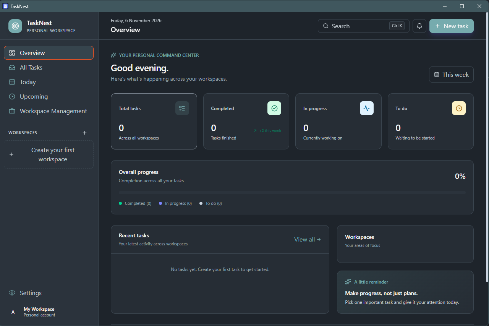
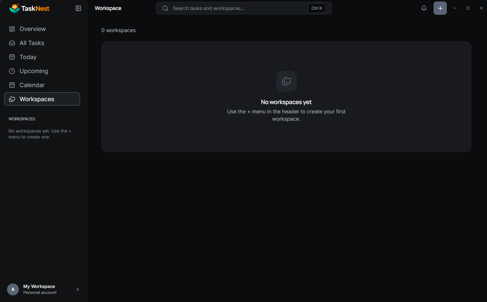
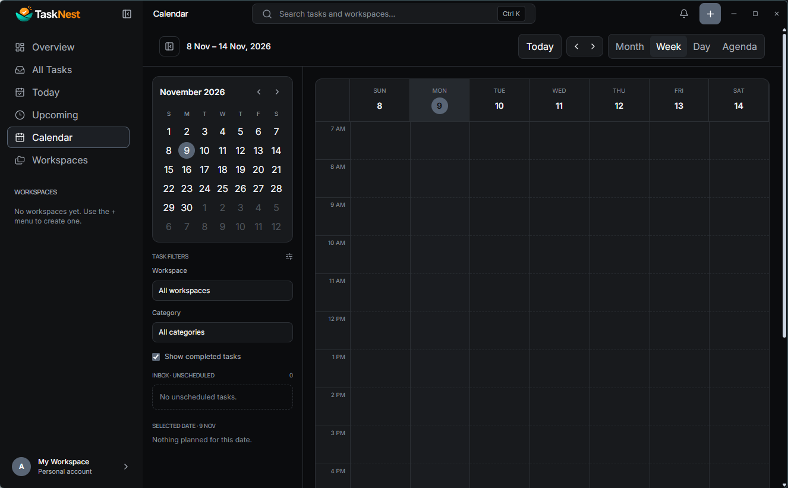
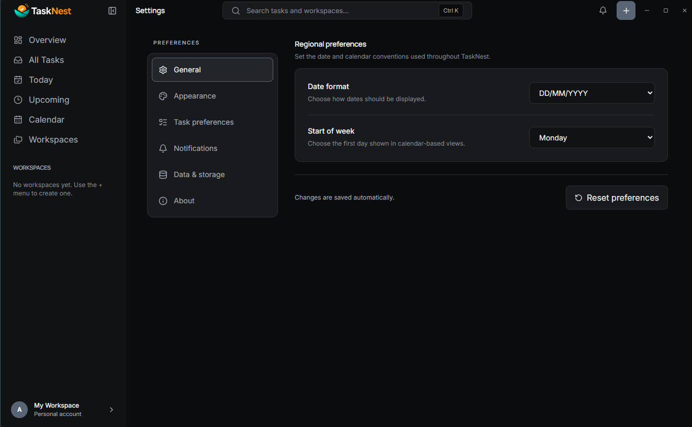
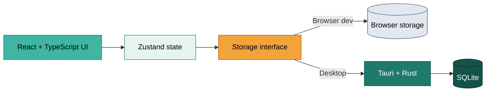

<p align="center">
  
</p>

**A fast, offline-first task manager for people who think in projects, not just to-do lists.**
Workspaces, nested categories, and a clean List/Kanban workflow, with all your data stored on your own device.

<br />

[](https://github.com/arnabsaha7/dewtask/releases/latest)
[](https://github.com/arnabsaha7/dewtask/releases)


<!-- TODO: add a license badge once a license is chosen -->

<br />

[Features](#features) &nbsp;·&nbsp;
[Screenshots](#screenshots) &nbsp;·&nbsp;
[Download](#download-and-install) &nbsp;·&nbsp;
[Build from source](#build-from-source) &nbsp;·&nbsp;
[Architecture](#architecture) &nbsp;·&nbsp;
[Roadmap](#roadmap) &nbsp;·&nbsp;
[Contributing](#contributing)

</div>

---

## Screenshots

<table align="center">
  <tr>
    <td align="center" width="50%">
      
      <br /><sub><b>Dashboard</b> · your work at a glance</sub>
    </td>
    <td align="center" width="50%">
      
      <br /><sub><b>Workspaces</b> · categories and subcategories</sub>
    </td>
  </tr>
  <tr>
    <td align="center" width="50%">
      
      <br /><sub><b>Calendar</b> · plan and track your schedule</sub>
    </td>
    <td align="center" width="50%">
      
      <br /><sub><b>Settings</b> · themes, preferences, backups</sub>
    </td>
  </tr>
</table>

<!-- TODO: add a Kanban view screenshot and a dark-theme screenshot. Kanban is a headline feature and is not shown yet. -->

---

## Why DewTask

Most to-do apps are either a flat list or a heavyweight project tool with an account and a subscription. DewTask sits in between:

- **Structure without overhead.** Separate workspaces for each project or area of life, with categories and subcategories nested as deep as you need.
- **Your data stays yours.** No account, no cloud, no internet requirement. Everything lives in a local SQLite database on your machine.
- **Portable by design.** One-click JSON export and import, so you are never locked in.

---

## Features

| Feature | What it gives you |
|---|---|
| **Workspaces** | Dedicated spaces for separate projects, responsibilities, or areas of life. |
| **Hierarchical organization** | Categories and subcategories inside each workspace. |
| **Task management** | Create, edit, organize, and track tasks. |
| **Priorities and statuses** | Mark what matters and see progress at a glance. |
| **List and Kanban views** | Switch layouts to match how you like to work; drag and drop to reorder. |
| **Tags and checklists** | Add lightweight labels and task-level detail. |
| **Calendar** | See and plan your schedule. |
| **Themes and preferences** | Customize appearance and regional settings. |
| **Backup and restore** | Export tasks, categories, tags, workspaces, and preferences to JSON, and restore them later. |
| **Offline-first** | Core features work with no connection and no account. |

---

## Download and install

The quickest way to use DewTask is the Windows installer. No build tools required.

<p align="center">
  <a href="https://github.com/arnabsaha7/dewtask/releases/latest">
    
  </a>
</p>

1. Open the [Releases page](https://github.com/arnabsaha7/dewtask/releases/latest).
2. Under **Assets**, download the latest `*-setup.exe`.
3. Run the installer and follow the prompts.
4. Launch **DewTask** from the Start menu.

> **Upgrading?** Export a backup first from **Settings → Data & Storage**, then install the newer version.

> **Windows SmartScreen:** if Windows warns about an unrecognized app, choose **More info → Run anyway**.
<!-- TODO: add one line explaining why (e.g. the installer is not yet code-signed). Users trust the workaround more when they know the reason. -->

**Requirements:** Windows 10 or later (64-bit) with the Microsoft Edge WebView2 Runtime, which is preinstalled on current Windows versions.
<!-- TODO: confirm the minimum supported Windows version. -->

---

## Data, backups, and privacy

DewTask is built around local data ownership.

- The desktop app stores its data in a local SQLite database on your device.
- Core features work fully offline.
- There is no automatic cloud sync.
<!-- TODO: if true, add "DewTask sends no telemetry and makes no network requests." This is a strong trust signal for an offline-first app. -->
<!-- TODO: document where the database file lives on Windows, so users can find it. -->

**Backups.** Open **Settings → Data & Storage** to export or import. An export is a single portable JSON file containing tasks, categories, tags, workspaces, and preferences. Importing **replaces** your current data after you confirm.

> Keep exported backups somewhere other than the machine running DewTask. A backup on the same disk will not help if the disk fails.

---

## Tech stack

| Layer | Technology | Role |
|---|---|---|
| Frontend | React, TypeScript | Interface and type safety |
| | Vite | Dev server and build tooling |
| | Tailwind CSS | Styling |
| | Zustand, dnd-kit, Lucide | State, drag and drop, icons |
| Desktop | Tauri 2 | Native desktop runtime |
| | Rust | Native backend |
| | SQLite | Local persistence |

---

## Architecture

The UI is separated from platform-specific persistence behind a storage interface, so features are not coupled to one storage implementation. The same frontend runs in the browser (for development) and in the desktop app.



**Current target:** Windows desktop. **Planned:** Android.

---

## Build from source

This section is for developers who want to run or build DewTask themselves.

### Prerequisites

- [Node.js](https://nodejs.org/) (includes npm)
- [Rust](https://www.rust-lang.org/tools/install) stable toolchain (MSVC)
- [Visual Studio 2022](https://visualstudio.microsoft.com/) or Build Tools with the **Desktop development with C++** workload
- [Microsoft Edge WebView2 Runtime](https://developer.microsoft.com/en-us/microsoft-edge/webview2/)
<!-- TODO: pin the minimum Node.js version (e.g. add an "engines" field to package.json and mention it here). -->

### Run

```bash
git clone https://github.com/arnabsaha7/dewtask.git
cd dewtask
npm install
```

```bash
# Web dev server (uses browser storage, not SQLite)
npm run dev

# Native desktop app (Tauri + SQLite)
npm run tauri:dev
```

The first desktop run is slower while Rust dependencies compile.

### Build the Windows installer

```bash
npm run tauri:build
```

The NSIS installer is written to `src-tauri/target/release/bundle/nsis/` as a `*-setup.exe`. If the first build times out while Tauri downloads its NSIS tooling, retry once the tools are available locally.

### Commands

| Command | Purpose |
|---|---|
| `npm run dev` | Vite development server |
| `npm run build` | Build the frontend |
| `npm run preview` | Preview the production frontend build |
| `npm run lint` | Run the linter |
| `npm run tauri:dev` | Run the native desktop app |
| `npm run tauri:build` | Build the desktop app and installer |

<details>
<summary><b>Project structure</b></summary>

<br />

```text
dewtask/
├── public/                  # Static assets
├── docs/
│   └── screenshots/         # README screenshots
├── src/
│   ├── components/
│   │   ├── layout/          # App layout and navigation
│   │   ├── settings/        # Settings screens
│   │   ├── tasks/           # Task components
│   │   └── workspaces/      # Workspace components
│   ├── hooks/
│   ├── themes/              # Theme definitions
│   ├── types/               # TypeScript types
│   ├── utils/               # Storage and utility modules
│   ├── App.tsx
│   └── main.tsx
├── src-tauri/
│   ├── capabilities/        # Tauri permissions
│   ├── icons/
│   ├── src/                 # Rust app and database code
│   ├── Cargo.toml
│   └── tauri.conf.json
├── index.html
├── package.json
├── tsconfig.json
└── vite.config.ts
```

</details>

---

## Roadmap

Shipped:

- [x] Workspaces with categories and subcategories
- [x] List and Kanban views, tags, checklists, priorities, statuses
- [x] Calendar
- [x] JSON backup and restore
- [x] Windows installer

Planned:

- [ ] More flexible workspace navigation and hierarchy
- [ ] Workflow automation and task auto-progression
- [ ] Further task organization and productivity improvements
- [ ] Continued desktop usability and performance work
- [ ] Android support
- [ ] Additional data-management capabilities

Track progress and vote on ideas in [Issues](https://github.com/arnabsaha7/dewtask/issues). The roadmap may change as development continues.
<!-- TODO: confirm the "Shipped" list matches what the app actually does today. -->

---

## Contributing

Contributions, ideas, and bug reports are welcome.

1. Fork the repository and create a feature branch.
2. Make your changes and test the affected functionality (`npm run lint` at minimum).
3. Open a pull request with a clear explanation of what changed and why.

For larger changes, please open an issue first so the approach can be discussed.

**Bug reports** should include a short description, steps to reproduce, expected versus actual behavior, your Windows version and DewTask version, and screenshots or logs if available.

---

## License

No open-source license has been specified yet, so all rights are reserved by the copyright holder. Until a license is added, the code may not be redistributed, modified, or used commercially.
<!-- TODO: pick a license (MIT or Apache-2.0 are common). Without one, outside contributions are legally murky, which conflicts with the Contributing section above. -->

---

## Author

**Arnab Saha**, creator and developer of DewTask · [@arnabsaha7](https://github.com/arnabsaha7)

<div align="center">

<br />

**DewTask** · *Organize your work. Structure your goals. Stay focused.*

[Star on GitHub](https://github.com/arnabsaha7/dewtask) &nbsp;·&nbsp; [Report a bug](https://github.com/arnabsaha7/dewtask/issues) &nbsp;·&nbsp; [Request a feature](https://github.com/arnabsaha7/dewtask/issues)


</div>